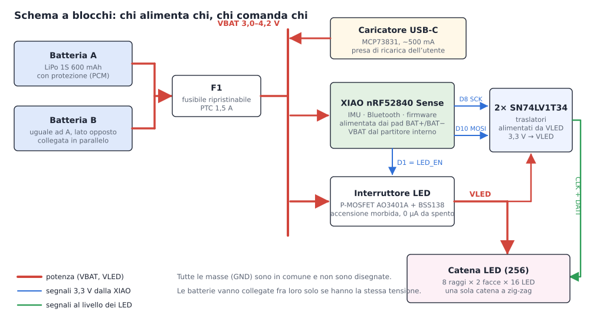
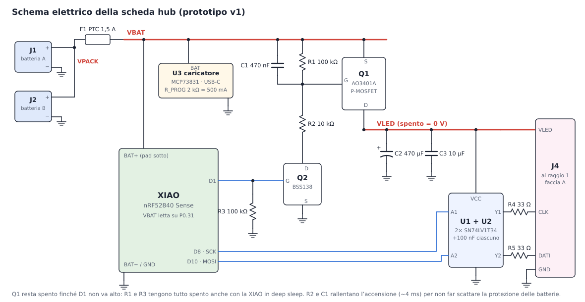
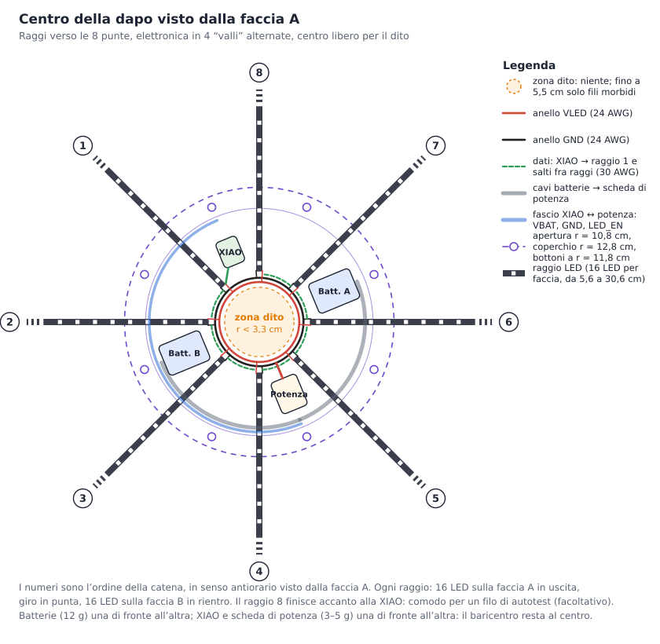
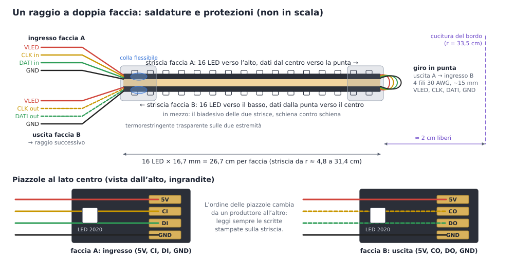
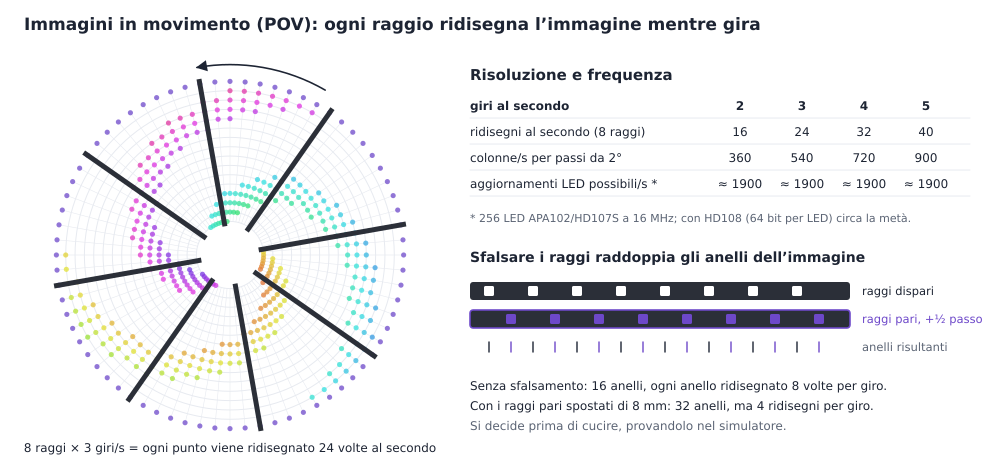
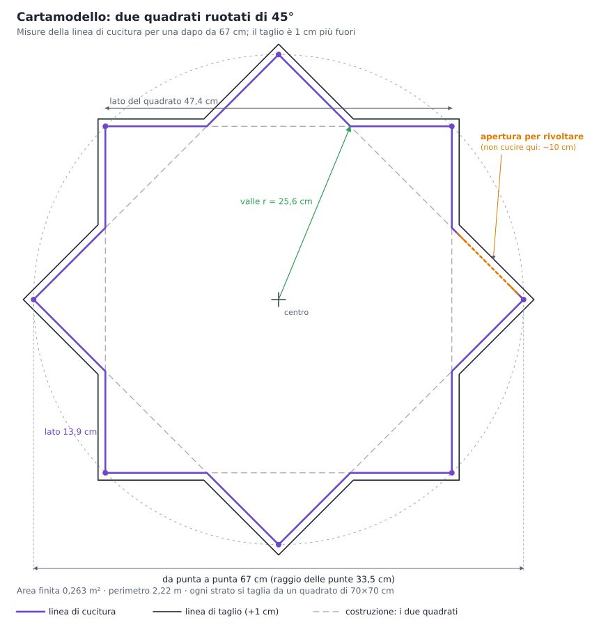
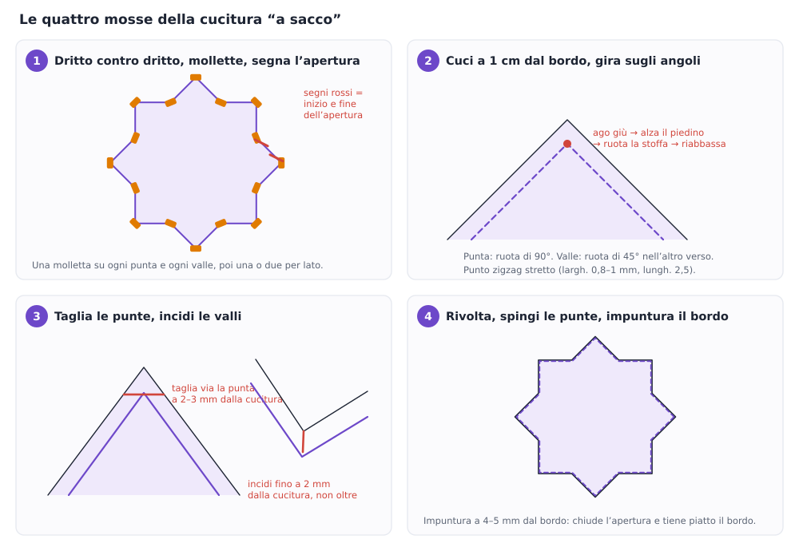
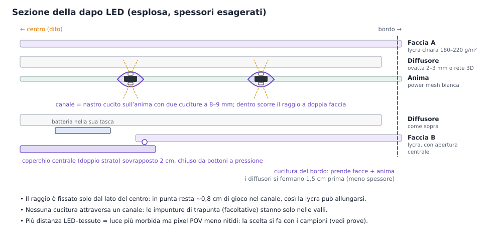

# Dapo Twin — guida di costruzione e analisi

**Versione 0.1 · 26 novembre 2026 · documento di ricerca e sviluppo**

Questa guida raccoglie tutto quello che serve per passare dal prototipo attuale (XIAO + batteria) a una dapo
con LED reattivi cucita da zero: elettronica, saldature, cucito per principianti, materiali, costi e una
prima analisi sulla vendita. Le scelte segnate con **da verificare** vanno confermate con una prova al banco o
con un prototipo: è normale, è ricerca e sviluppo. Quando trovi un dubbio annotalo: la versione 0.2 nasce da lì.

> **Correzione rispetto ai messaggi precedenti.** Avevo indicato il 74AHCT125 come traslatore di livello per
> i LED. Con i LED alimentati direttamente dalla LiPo (3,0–4,2 V) è **fuori specifica**: quel chip vuole 4,5–5,5 V.
> Il componente giusto è lo **SN74LV1T34** (uno per il clock e uno per i dati). Il perché è nella sezione 2.2.

## 0. Le decisioni in una pagina

| Tema | Scelta consigliata | Perché | Da verificare |
|---|---|---|---|
| LED | **Prototipo:** striscia APA102-2020 da 4 mm, 60 LED/m. **Versione 2:** HD107S-2020 su circuito flessibile su misura; HD108 se esiste in formato 2020 | PWM veloce (≥ 19 kHz): niente scie tratteggiate quando gira, adatti alle immagini POV | funzionamento a 3,3–4,2 V; corrente a riposo |
| Quanti LED | 8 raggi × 2 facce × 16 LED = **256** | luce verso le punte, su entrambe le facce | — |
| Alimentazione LED | **direttamente dalla LiPo** (3,0–4,2 V) | circa +45% di autonomia rispetto a un elevatore a 5 V | colori sotto 3,6 V |
| Traslatore di livello | **2× SN74LV1T34** alimentati dalla linea LED | funziona da 1,65 a 5,5 V; il 74AHCT125 no | — |
| Interruttore dei LED | P-MOSFET AO3401A + BSS138 | i LED spenti consumano lo stesso fino a 0,2 A: va tolta l'alimentazione | — |
| Batteria | **2 LiPo protette da 600 mAh** in parallelo, una di fronte all'altra | bilanciamento; ~1,6 h in uso normale | corrente massima delle celle |
| Ricarica | caricatore da 500 mA con la sua USB-C | la XIAO carica a 50–100 mA: 12–24 ore | temperatura nella tasca |
| Accensione | **nessun pulsante esterno**: risveglio col movimento + gesto, spegnimento automatico e da app, spina nascosta nella tasca | nessuno spegnimento accidentale durante i trick | soglie dei gesti |
| Tessuto | lycra chiara + diffusore sottile + "anima" in power mesh con i canali dei raggi | luce morbida su entrambe le facce, si comporta come una dapo vera | campioni di diffusione |
| Misure | 67 cm da punta a punta, peso finale 260–330 g | come le dapo in commercio | sensazione in mano |
| Accesso all'elettronica | coperchio centrale sulla faccia B, chiuso da bottoni a pressione | batteria sostituibile (obbligo UE dal 2027), si gira la dapo attraverso il foro | comfort sul dito |

**Il percorso consigliato:** prima impari a cucire una dapo normale (prototipo P1), poi ne fai una con i pesi
finti dell'elettronica (P2), intanto al banco costruisci e provi un raggio LED completo, poi metà dapo LED (P3) e
infine quella completa (P4). Il piano dettagliato è nella sezione 8.

## 1. Il progetto in breve

La dapo è una stella a 8 punte di lycra. Al centro, in quattro "valli" alternate, stanno due batterie, la XIAO
e una piccola scheda di potenza. Da lì partono 8 raggi di LED verso le punte. Ogni raggio è fatto di due
strisce incollate schiena contro schiena: una illumina la faccia A, l'altra la faccia B.
Tutti i 256 LED sono un'unica catena: il firmware sa quale LED è dove e lo colora in base al movimento
misurato dall'IMU.

**Budget di peso (stima):**

| Parte | Peso |
|---|---|
| Facce A e B (lycra 190 g/m², 0,263 m² ciascuna) | ~100 g |
| Anima in power mesh, diffusori in ovatta sottile (con foro centrale) | ~60 g |
| Coperchio, bordo del foro, bottoni, canali, filo | ~25 g |
| Strisce LED (4,3 m da 4 mm) e cavi | ~25 g |
| 2 batterie da 600 mAh | ~24 g |
| XIAO, scheda di potenza, custodie | ~20 g |
| **Totale** | **~255 g** |

Le dapo in commercio pesano 350–370 g. La nostra è più leggera: se in mano ti sembra "vuota", si aggiunge peso
dove serve (lycra più pesante, oppure un cordoncino nel bordo che porta 15–20 g sul perimetro e rende lo spin
più stabile). Lo si decide con i prototipi, non a tavolino.

## 2. Elettronica

### 2.1 Come è collegato tutto

- Le **due batterie** sono in parallelo sulla scheda di potenza. Da lì passano per un **fusibile ripristinabile**
  (PTC) e diventano la linea **VBAT**.
- **VBAT** alimenta tre cose: la **XIAO** (dai pad BAT+ e BAT− sotto la scheda), il **caricatore** (che la riempie
  quando colleghi la USB-C) e l'**interruttore dei LED**.
- L'interruttore crea la linea **VLED**, accesa solo quando servono i LED. VLED alimenta i LED e i due
  **traslatori di livello**, che portano i segnali della XIAO (3,3 V) al livello giusto per i LED.
- Regola d'oro: la corrente dei LED (fino a 1–2 A) **non passa mai dalla XIAO**. Va dalle batterie alla scheda di
  potenza e da lì all'anello di alimentazione dei raggi, con cavi adeguati.

### 2.2 Perché serve un traslatore di livello (e perché non il 74AHCT125)

Un chip digitale legge "1" quando la tensione sul suo ingresso supera una soglia chiamata **VIH**. Nei LED
indirizzabili come gli APA102 la soglia è circa il **70% della loro alimentazione**. La XIAO però esce sempre a
**3,3 V**, qualunque sia l'alimentazione dei LED.

- **LED a 5 V:** soglia ≈ 3,5 V. I 3,3 V della XIAO non bastano: il primo LED può leggere bit sbagliati.
  Il datasheet dell'HD108 lo dice esplicitamente: a 5 V vuole almeno 3,4 V per un "1".
  Qui serve un traslatore, e il classico è il **74AHCT125**: alimentato a 5 V, ha ingressi "TTL" che leggono come
  "1" già 2 V, quindi capisce i 3,3 V della XIAO e li ripete a 5 V. Per questo lo trovi in tutte le guide.
- **LED direttamente dalla LiPo (il nostro caso):** l'alimentazione va da 4,2 V (carica) a 3,0 V (scarica).
  Il 74AHCT125 è garantito solo fra 4,5 e 5,5 V: sotto funziona male o non funziona. **Era un mio errore.**
- Senza traslatore, a batteria carica la soglia dell'APA102 è circa 2,9 V contro i 3,3 V della XIAO: restano 0,4 V
  di margine. Con cavi lunghi, fronti veloci e i disturbi di massa dei LED che si accendono, quel margine sparisce e
  compaiono **colori a caso e sfarfallii**, soprattutto ad alta velocità di clock.

**La soluzione: SN74LV1T34** (Texas Instruments, oppure 74LV1T34 di Nexperia). È un buffer singolo che si
alimenta da 1,65 a 5,5 V e ha le soglie d'ingresso abbassate apposta per tradurre i livelli: alimentato dalla
linea LED, legge i 3,3 V della XIAO come "1" a qualunque tensione della batteria e li ripete al livello dei LED.
Costa circa 0,26 € l'uno. Ne servono **due** (clock e dati). Oltre a tradurre, rinforza il segnale per il cavo
fino al primo raggio e protegge i pin della XIAO da cortocircuiti ed elettricità statica sui fili.

Accorgimenti:

- Alimentali da **VLED**, così si spengono insieme ai LED. Prima di togliere VLED il firmware porta a 0 i pin del
  clock e dei dati (buona abitudine).
- Metti un condensatore da 100 nF fra VCC e GND di ciascuno, attaccato al chip.
- Una resistenza da 33 Ω in serie su ogni uscita smorza i rimbalzi sul cavo.
- Se un giorno passassi a un elevatore a 5 V, allora il 74AHCT125 (o il 74HCT245) tornerebbe la scelta giusta.

**Perché non un elevatore a 5 V?** I LED hanno driver a corrente costante: con più tensione non fanno più luce,
la scaldano. A parità di luce, a 5 V con un elevatore al 90% di efficienza la batteria eroga
5 ÷ 0,9 ≈ 5,6 W per ampere ai LED; direttamente dalla LiPo (in media 3,8 V) ne eroga 3,8. È circa il **45% di
energia in più** buttata in calore. Il prezzo della LiPo diretta: sotto circa 3,6 V il blu e il verde
calano un po'. Il firmware lo compensa e spegne i LED a circa 3,4 V, prima che intervenga la protezione delle celle.

### 2.3 Quali LED per l'effetto più bello

Quello che conta su un oggetto che gira:

1. **Frequenza PWM.** I LED regolano la luminosità accendendosi e spegnendosi migliaia di volte al secondo.
   A 3 giri al secondo un LED a 30 cm dal centro corre a 5,7 m/s. Per ogni ciclo PWM percorre:
   0,2 mm a 27 kHz (HD107S/HD108), 0,3 mm a 19 kHz (APA102), 1,2 mm a 4,7 kHz (SK9822), **13 mm** a circa 430 Hz
   (WS2812). Con i WS2812 la scia diventa un tratteggio; con gli altri è una linea continua. Conta anche quando
   filmi col telefono.
2. **Velocità dei dati.** I LED a due fili (clock + dati) si aggiornano molto più in fretta di quelli a un filo.
   È quello che serve per reagire subito ai movimenti e per le immagini POV (sezione 3).
3. **Profondità di colore.** 8 bit per canale bastano quasi sempre. I 16 bit dell'HD108 si notano nelle sfumature
   lente a bassa luminosità, dove gli 8 bit fanno "scalini".

| Chip | PWM | Clock max | Colore | Luminosità globale | Consumo da spento | Formato da 4 mm | Verdetto |
|---|---|---|---|---|---|---|---|
| APA102-2020 | ~19–20 kHz | ~20–30 MHz | 8 bit | con un secondo PWM lento: tienila al massimo | ~0,7–1 mA per LED | **striscia in vendita** | prototipo |
| SK9822-2020 | 4,7 kHz | 30 MHz | 8 bit | a corrente (bene) | simile | qualche striscia | PWM al limite |
| HD107S-2020 | ~26–27 kHz | 40 MHz | 8 bit | a corrente costante | ~0 secondo il datasheet | solo chip sfusi | **versione 2** |
| HD108 | 27–28 kHz | 32–40 MHz | **16 bit** | 5 bit per canale | ~0 secondo il datasheet | strisce 5050; 2020 annunciato | da provare |
| WS2812 / SK6812 (anche "side fire") | ~0,4–1 kHz | 0,8 Mbit/s | 8 bit | — | ~1 mA | molte | **no** |

Scelta concreta:

- **Prototipo (adesso):** striscia **APA102-2020 da 4 mm, 60 LED/m** (Superlightingled, modello APA102-2020-60W4,
  circa 20 $/m). È l'unica striscia da 4 mm a due fili facile da comprare. Con gli APA102 il firmware lascia la
  luminosità globale a 31 e regola solo i colori: il loro "globale" è un secondo PWM a poche centinaia di hertz,
  che girando si vedrebbe.
- **Versione 2 (la più bella):** raggi su **circuito flessibile su misura** (JLCPCB) con chip **HD107S-2020**
  (~0,24 € l'uno in confezioni da 500) o **HD108** se lo trovi in 2020. Vantaggi: PWM a 27 kHz, luminosità
  globale a corrente costante (sfumature pulite), consumo quasi nullo da spenti, giro in punta già nel circuito,
  stesso passo su tutte le facce, e la possibilità di sfalsare i raggi per il POV.
- **Diffusione:** la decide il tessuto, non la striscia. Una striscia "più diffusa" (COB, side fire) usa chip a un
  filo e lento: peggiore per il movimento. Meglio LED nitidi e veloci, poi si ammorbidisce la luce con la distanza
  dal tessuto (sezione 4.6). C'è un compromesso: più diffusione = bagliore più morbido ma pixel POV meno nitidi.
  Si sceglie con i campioni.

**Da verificare al banco:** HD107S e HD108 sono specificati per 4,5–5,5 V. A 3,3–4,2 V vanno provati
(sezione 8): se non funzionano bene, si resta sugli APA102 oppure si passa a 5 V con l'elevatore.

### 2.4 LED su due facce: come funziona e quanto consumano

Ogni raggio ha due strisce incollate schiena contro schiena. La catena fa uno zig-zag:
centro → punta sulla faccia A, giro in punta, punta → centro sulla faccia B, poi passa al raggio successivo.
Così basta **una sola catena** e due fili di segnale.

**Comandare le facce separatamente non costa nulla:** ogni LED ha il suo indirizzo, quindi il firmware può
mostrare lo stesso colore sui due LED gemelli (impostazione normale) oppure fare cose diverse sulle due facce.
Per esempio il testo POV leggibile da entrambi i lati, o un colore per la faccia rivolta in alto e uno per quella
in basso. Lo decidi da app, non dal cablaggio.

**Consumano il doppio?** Dipende da come imposti il budget:

- Ogni LED consuma in proporzione a quanto è acceso. Il doppio dei LED alla **stessa luminosità** = il doppio
  della corrente. La luce di una faccia non arriva all'altra.
- Il firmware però ha un **tetto di corrente totale** (per esempio 1 A). Con le due facce sotto lo stesso tetto,
  ogni LED lavora a metà. L'occhio non è lineare: metà luce sembra circa il **70%**. In pratica la dapo dura uguale e
  ogni faccia sembra un po' meno luminosa. Oppure tieni la luminosità e accetti metà autonomia. È uno slider nell'app.
- Trucco "**modalità pubblico**": l'IMU sa quale faccia guarda in basso (verso chi ti guarda quando la fai girare
  sopra la testa) e può darle più budget.
- **Il consumo a riposo raddoppia davvero:** un APA102 acceso ma nero assorbe circa 0,7–1 mA. Con 256 LED fa
  circa **0,2 A anche a LED spenti**, cioè una batteria da 1,2 Ah scarica in 6 ore senza fare luce.
  Per questo la linea LED ha un **interruttore a MOSFET** che la toglie del tutto. Gli HD107S/HD108 dichiarano un
  consumo statico quasi nullo: è un motivo in più per la versione 2 (da misurare).
- Anche i dati raddoppiano: con 256 LED e clock a 16 MHz restano circa 1900 aggiornamenti al secondo, più che
  abbastanza.

### 2.5 La batteria: quanta, quale, dove

**Quanta corrente serve.** Al bianco pieno un LED 2020 assorbe circa 20 mA (le strisce APA102-2020 da 4 mm sono
date per 6 W/m a 5 V con 60 LED/m). 256 LED al bianco pieno farebbero 5,1 A: impossibile e inutile, perché il
tessuto diffonde e di notte basta molto meno. Il firmware limita la corrente media e conta quanta ne sta usando.

**Autonomia stimata** con 2 × 600 mAh (circa 1 Ah utilizzabile):

| Uso | Carico medio (% del bianco pieno) | APA102 (+0,21 A a riposo) | Autonomia | HD107S (riposo ~0) | Autonomia |
|---|---|---|---|---|---|
| Notte, effetti morbidi | 3% | 0,36 A | ~2,8 h | 0,16 A | ~6 h |
| Normale, reattivo | 8% | 0,62 A | ~1,6 h | 0,42 A | ~2,4 h |
| Show, colori pieni | 20% | 1,23 A | ~0,8 h | 1,03 A | ~1 h |

Lo "show" è al limite della scarica continua di due celle normali (1C = 1,2 A): per quell'uso servono celle da
2C o 2 × 1000 mAh. Nel firmware il tetto di corrente si regola sulla batteria montata.

**Quale batteria.** Celle **LiPo da 1 cella (3,7 V) con circuito di protezione (PCM)** di un produttore che
fornisce datasheet e test di trasporto UN 38.3 (Jauch, EEMB, PKCELL e simili). Esempio:
**Jauch LP503040JH+PCM, 600 mAh, 42 × 30,5 × 5,4 mm**, circa 7,70 € su DigiKey (6 € a partire da 25 pezzi).
Niente LiPo da modellismo senza protezione: in un oggetto che si lancia e si schiaccia la protezione è obbligatoria.

**Perché due celle e non una grande.** Il centro deve restare libero per il dito, quindi la batteria sta fuori
asse. Una sola cella richiederebbe un contrappeso inutile dall'altra parte. Due celle uguali una di fronte
all'altra si bilanciano da sole, e in parallelo raddoppiano capacità e corrente disponibile.

**Quanto grande al massimo.** Fino a 2 × 1000 mAh (circa 20 g e 50 × 34 × 6 mm l'una) il peso resta accettabile.
Prima di comprare, **prova con le monete**: una moneta da 1 € pesa 7,5 g, da 2 € 8,5 g. Fissa 12 g o 20 g per
lato nelle valli della dapo P2 e senti come cambia lo spin e il lancio.

**Bilanciamento.** Il baricentro deve restare entro circa 1 mm dal centro. Con una dapo di 300 g significa al
massimo 30 g·cm di squilibrio: 3 g in più a 10 cm dal centro già si sentono. Le batterie si bilanciano fra loro,
XIAO e scheda di potenza (3–5 g ciascuna) stanno una di fronte all'altra, e le differenze si correggono con una
rondella. Prova finale: appoggia la dapo finita al centro su una gomma da matita: deve restare orizzontale.

**Regole per il parallelo:** stesse celle, stesso lotto, e **caricale entrambe alla stessa tensione** (differenza
sotto 0,05 V) prima di collegarle fra loro. Mai collegare una cella carica a una scarica.

**La ricarica.** Il caricatore della XIAO dà 50 mA (100 mA impostando un pin): per 1200 mAh servirebbero
12–24 ore. Serve un **caricatore dedicato da 500 mA** (chip MCP73831) con la sua presa USB-C: circa 2,5–3 ore.
Per il prototipo va bene un modulo pronto (per esempio SparkFun LiPo Charger Basic, circa 10 $); nella versione
2 lo stesso chip sta sulla scheda hub. La USB-C della XIAO resta per la programmazione via cavo (che ormai serve di
rado, perché il firmware si aggiorna dal browser).

**Sicurezza delle batterie:**

- Ogni cella nella sua custodia semirigida (TPU stampato in 3D) con un velo di imbottitura. **Mai cucire vicino a
  una cella**, mai ago o spillo nella zona delle batterie.
- Niente ricarica dentro una borsa chiusa o sotto un cuscino; carica su una superficie non infiammabile.
- Se una cella si gonfia, sostituiscila. Per lunghi periodi di inutilizzo lasciala a metà carica.
- Doppia protezione elettrica: PCM in ogni cella, fusibile PTC sulla scheda, limite di corrente e spegnimento a
  bassa tensione nel firmware.

### 2.6 Accensione senza pulsante esterno

Un pulsante sulla dapo verrebbe premuto per sbaglio durante i trick. Quindi **niente pulsante esterno**:

| Stato | Cosa succede | Consumo |
|---|---|---|
| **Spenta** | XIAO in System OFF; l'IMU resta sveglio in basso consumo e controlla il movimento | decine di µA: mesi in standby |
| **Sveglia** | dopo il movimento giusto: Bluetooth acceso, LED ancora spenti | ~10 mA |
| **Accesa** | LED accesi, effetti reattivi | dipende dagli effetti |
| **Trasporto** | batterie scollegate dalla spina nella tasca | zero |

- **Accensione:** l'IMU della XIAO Sense ha un pin d'interruzione (INT1) che sveglia il processore, per esempio con
  un doppio colpetto. Il firmware poi chiede una conferma, per esempio un giro sul dito o due colpetti in più. Se non
  arriva entro 10 s torna a dormire, così la dapo non si accende scossa in uno zaino.
- **Spegnimento:** dall'app, oppure automatico se resta immobile per un tempo che scegli tu (per esempio 3 minuti),
  oppure con un gesto (a faccia in giù sul tavolo per 5 s). In "modalità show" il gesto è disattivato: si spegne
  solo da app o per inattività.
- **Interruttore di trasporto:** per voli, spedizioni e lunghi periodi basta staccare il connettore delle batterie
  dentro la tasca centrale. Nella versione 2 diventa un piccolo interruttore a slitta nascosto che comanda un MOSFET.
- Il pulsantino di reset della XIAO resta dentro la tasca, in una custodia. Anche se venisse premuto, la dapo
  si riavvia in un secondo: non si spegne.

### 2.7 Schema elettrico della scheda hub

Lo schema completo è nella pagina seguente (nel PDF è ruotato per leggerlo più grande). I componenti:

| Rif. | Componente | Note |
|---|---|---|
| J1, J2 | connettori JST-PH 2 poli | uno per batteria; staccandoli si spegne tutto |
| F1 | PTC 1812, 1,5 A di mantenimento | protegge i fili da un corto in un raggio |
| U3 | caricatore MCP73831 con USB-C | R_PROG 2 kΩ = 500 mA; modulo pronto nel prototipo |
| Q1 | AO3401A (P-MOSFET, SOT-23) | interruttore della linea LED |
| Q2 | BSS138 (N-MOSFET, SOT-23) | comanda Q1 dal pin D1 della XIAO |
| R1, R3 | 100 kΩ | tengono tutto spento quando la XIAO dorme |
| R2, C1 | 10 kΩ e 470 nF | accensione morbida in ~4 ms: niente picco che faccia scattare la protezione |
| C2, C3 | 470 µF elettrolitico a bassa ESR (6,3 V) + 10 µF ceramico | riserva per i picchi dei LED |
| U1, U2 | SN74LV1T34 (SOT-23-5) + 100 nF ciascuno | traslatori di clock e dati |
| R4, R5 | 33 Ω | in serie alle uscite verso il raggio 1 |

**Pin della XIAO:** D8 (SCK) = clock, D10 (MOSI) = dati, D1 = accensione LED. La tensione della batteria si legge
col partitore interno della XIAO. L'IMU è già dentro la XIAO.

Per il prototipo la scheda si monta su una basetta millefori. I componenti SOT-23 si saldano bene su **adattatori
SOT-23 → passo 2,54 mm** (pochi euro): è la cosa più facile se non hai mai saldato componenti SMD.

### 2.8 Cablaggio e saldature

**La catena.** Parte dai traslatori vicino alla XIAO, entra nel raggio 1 dalla faccia A, torna dalla faccia B,
salta al raggio 2 con due fili corti (clock e dati), e così via fino al raggio 8, che finisce di nuovo vicino alla
XIAO. L'alimentazione invece arriva a ogni raggio da un **anello** di due fili (VLED e GND) intorno al centro:
così nessun raggio deve portare la corrente degli altri.

**Le distanze** (dal centro):

| Zona | Raggio | Cosa c'è |
|---|---|---|
| Dito | 0–3,3 cm | niente di niente |
| Anello | 3,8 e 4,2 cm | VLED e GND, cavo in silicone 24 AWG |
| Salti dei dati | ~4,5 cm | coppie di fili 30 AWG fra un raggio e il successivo |
| Elettronica | 5,6–10 cm | nelle valli: batteria A a 22,5°, XIAO a 112,5°, batteria B a 202,5°, potenza a 292,5° |
| LED | 5,6–30,6 cm | 16 LED per faccia, passo 16,7 mm; la striscia va da 4,8 a 31,4 cm |
| Bordo | 33,5 cm | cucitura: almeno 2 cm liberi oltre la fine della striscia |

**Cavi e colori** (usa sempre cavo in silicone a trefoli, morbido e resistente al calore):

| Collegamento | Sezione | Colore |
|---|---|---|
| Batterie → scheda di potenza | 22 AWG | rosso / nero |
| Anello VLED e GND | 24 AWG | rosso / nero |
| Anello → ogni raggio | 26 AWG | rosso / nero |
| Clock e dati, salti fra raggi, giro in punta | 30 AWG | giallo (clock) / verde (dati) |
| XIAO ↔ scheda di potenza | 28–30 AWG | rosso, nero, blu (LED_EN) |

**Attrezzatura per saldare:** saldatore a temperatura regolabile con punta fine (conica o a scalpello da 1 mm),
stagno 0,5 mm con flussante (quello con piombo è più facile per imparare: lavora con la finestra aperta e lavati le
mani), penna di flussante, pinzette, "terza mano" con lente, multimetro, alimentatore da banco con limite di
corrente (lo strumento più utile per provare i LED senza bruciarli), pistola termica o phon da modellismo.

**Costruire un raggio, passo per passo:**

1. **Taglia** due pezzi da 16 LED (26,7 cm) sulle linee di taglio, a metà delle piazzole. Segna con un pezzetto di
   nastro quale sarà A e quale B, e controlla le **frecce** stampate: indicano il verso dei dati.
2. **Prova i pezzi prima di saldare** qualunque cosa: alimentatore a 3,7 V con limite a 0,3 A e lo sketch di prova
   dei LED sulla XIAO. Un LED difettoso si scopre adesso, non dopo aver cucito.
3. **Stagna** piazzole e fili: un tocco di flussante, poco stagno. Spella i fili di 1,5–2 mm, attorcigliali e
   stagnali.
4. **Salda i fili lato centro:** quattro fili di circa 8 cm sull'ingresso della striscia A (5V, CI, DI, GND) e quattro
   sull'uscita della striscia B (5V, CO, DO, GND). Ogni saldatura dura al massimo 2–3 secondi: il datasheet dei LED
   2020 fissa a 5 secondi il limite oltre il quale il LED si danneggia. Se non riesce, lascia raffreddare e riprova.
5. **Salda il giro in punta:** quattro fili da ~15 mm dall'uscita di A (5V, CO, DO, GND) all'ingresso di B (5V, CI,
   DI, GND).
6. **Controlla** con lente e multimetro che non ci siano ponti fra piazzole vicine. **Prova la coppia** (32 LED).
7. **Incolla** le strisce schiena contro schiena con il loro biadesivo, LED allineati. Piega il giro in punta con
   dolcezza, mai a spigolo.
8. **Scarica le tensioni meccaniche:** una goccia di colla flessibile (per esempio E6000 o silicone neutro) sopra
   le saldature, con i fili stesi lungo la striscia; quando è asciutta, termorestringente trasparente sulle due
   estremità. Scalda con aria calda moderata e da lontano.
9. **Prova di nuovo** e scrivi il numero del raggio sul termorestringente.

**Montare il centro:**

1. Costruisci la scheda di potenza e provala **senza LED**: con D1 basso VLED deve essere 0 V, con D1 alto deve
   arrivare VBAT in pochi millisecondi.
2. Collega l'anello VLED/GND e **un solo raggio**. Provalo. Aggiungi i raggi uno alla volta: se qualcosa smette di
   funzionare sai subito dove.
3. I salti dei dati fra i raggi sono coppie di fili 30 AWG attorcigliati: corti e lontani dai cavi delle batterie.
4. Lascia sempre un'**ansa di cavo** (1–2 cm in più) a ogni collegamento: quando la dapo si piega, tira l'ansa e
   non la saldatura.
5. Prova di durata prima di cucire: piega ogni raggio 200 volte a mano con raggio ampio e rifai il test.

## 3. Immagini in movimento (POV)

Quando la dapo gira, ogni raggio passa in ogni punto del cerchio. Se il firmware sa in ogni istante l'angolo di
ogni raggio, può accendere i LED con il colore del "pixel" su cui stanno passando: l'occhio fonde le scie e vede
un'immagine ferma o animata. È la persistenza della visione (POV), la stessa delle pixel poi.

**Perché la dapo è adatta:** con **8 raggi** ogni punto viene ridisegnato 8 volte per giro. A 3 giri al secondo
sono 24 ridisegni al secondo, come un ventilatore POV a due pale che gira a 12 giri/s. Con un raggio solo
sfarfallerebbe molto.

**Cosa serve, e a che punto siamo:**

| Requisito | Valore | Stato |
|---|---|---|
| PWM alto | ≥ 19 kHz | APA102 sì; HD107S/HD108 meglio |
| Aggiornamenti dei LED | 500–2000 al secondo | con 256 LED a 16 MHz circa 1900/s (HD108 circa la metà) |
| Angolo in tempo reale | giroscopio letto e integrato ad almeno 1 kHz | oggi il firmware legge a 416 Hz: si alza a 1,66 kHz |
| Velocità massima | il giroscopio arriva a ±2000 °/s = **5,5 giri/s** | **da misurare**: quanto gira davvero la tua dapo? |
| Riferimento assoluto | in verticale (a ruota) la gravità; in orizzontale serve un magnetometro | senza magnetometro l'immagine ruota piano: va bene per mandala, spirali, anelli |

**Risoluzione.** Con 16 LED per raggio l'immagine ha 16 anelli, larghi 16,7 mm. Con passi angolari di 2° i
"pixel" verso il bordo sono di circa 1 × 1,7 cm. Basta per forme, simboli, scritte corte e animazioni astratte,
non per fotografie. Per raddoppiare gli anelli si possono **sfalsare i raggi pari di mezzo passo** (8 mm): 32 anelli,
ma ogni anello si ridisegna 4 volte per giro invece di 8. È una scelta da fare **prima di cucire**, provandola nel
simulatore (prossimo passo, sezione 8).

**Limiti onesti:**

- L'immagine si vede bene di fronte: quando giri la dapo a ruota verso il pubblico, o dal basso quando gira sopra la
  testa. Di taglio si schiaccia.
- Ogni LED copre una piccola parte del cerchio, quindi l'immagine è molto più scura del LED acceso fermo. Il POV è
  un effetto da sera o da buio.
- La stoffa si deforma: verso le punte l'immagine ondeggia un po'. Fa parte del fascino.
- Durante i lanci con rotazioni strane non c'è un piano di rotazione stabile: lì si usano effetti normali e il POV
  riparte quando lo spin si stabilizza.
- Con le due facce indipendenti il testo si può mostrare **leggibile da entrambi i lati** (sul retro speculare).

**Sequenza di sviluppo consigliata:** prima misurare gli spin veri con il firmware attuale e il Dapo Lab (giri al
secondo, oscillazioni); poi aggiungere al simulatore la **simulazione della persistenza** e un convertitore
immagine → coordinate polari; poi il driver dei LED veloce nel firmware; per ultimo, se serve, il magnetometro
(un sensore esterno da 1–3 €).

## 4. Cucire la dapo da zero

Non hai mai cucito: va benissimo. La dapo è una forma semplice con cuciture dritte. La difficoltà vera è la
lycra, che scivola e si allunga, e gli angoli (8 punte e 8 valli). Si impara in un pomeriggio, sbagliando su
stoffa economica.

### 4.1 Attrezzatura e materiali

**Macchina per cucire.** Serve una macchina con **punto zigzag** (ce l'hanno quasi tutte). Opzioni: farsela
prestare, usarne una in un makerspace o in un laboratorio di sartoria, o comprarne una di base (indicativamente
130–250 € nuova, 50–100 € usata). La taglia-cuci (overlock) non serve. Cucire a mano si può, ma è lento.

| Attrezzo | Note | Costo indicativo |
|---|---|---|
| Aghi **stretch 75/11** (o jersey 80/12) | gli aghi normali saltano i punti sulla lycra | 4–6 € |
| Filo di poliestere per tutti gli usi | non cotone: si spezza quando la lycra si allunga | 3–5 € a rocchetto |
| Mollette da cucito (~30) | meglio degli spilli sulla lycra | 6–10 € |
| Taglierina rotante 45 mm + tappetino + righello | taglio preciso senza spostare la stoffa | 35–60 € |
| oppure forbici da stoffa | da usare **solo** per la stoffa | 15–25 € |
| Gesso da sarto o pennarello cancellabile | per tracciare sul rovescio | 3–5 € |
| Carta da modelli o carta da pacchi | per il cartamodello | 5–10 € |
| Metro da sarta, squadra, filo e puntina | il filo e la puntina fanno da compasso | — |
| Girapunte (o una bacchetta di bambù) | per far uscire bene le punte | 3 € |
| Scucitore | lo userai, è normale | 2 € |
| Pinza e bottoni a pressione in plastica | per il coperchio della versione LED | 15–20 € |

**Tessuti:**

| Materiale | A cosa serve | Quanto |
|---|---|---|
| **Lycra** (poliammide o poliestere + elastan, 180–220 g/m², larghezza 150 cm) | le due facce; chiara e opaca sopra i LED | 1 m = 2 strati |
| Lycra stampata in sublimazione con la tua grafica | facce decorate (su base bianca la luce passa) | circa 23 €/m |
| Power mesh bianca (rete elastica) | l'"anima" della versione LED, con i canali | 0,8 m |
| Ovatta sottile di poliestere (80 g/m²) o rete 3D da 2–3 mm | diffusore della luce | 1 m |
| Nastro leggero o sbieco bianco, 2 cm | i canali dei raggi | 10 m |
| Elastico ripiegabile (fold-over) 1,5–2 cm | bordo del foro centrale | 1 m |

Un consiglio da negozio: chiedi "lycra opaca per danza o costumi" e prendi per il primo prototipo il colore più
economico. Ogni strato si taglia da un quadrato di 70 × 70 cm, quindi da 1 m di tessuto alto 150 cm escono due
strati affiancati.

### 4.2 Il cartamodello

La dapo è l'unione di **due quadrati uguali ruotati di 45°** con lo stesso centro. Per 67 cm da punta a punta:

| Misura (linea di cucitura) | Valore |
|---|---|
| Distanza punta–punta | 67 cm (punte a 33,5 cm dal centro) |
| Lato di ciascun quadrato | 47,4 cm |
| Distanza delle valli dal centro | 25,6 cm |
| Lato fra una punta e una valle | 13,9 cm |
| Margine di cucitura | 1 cm (già compreso nel cartamodello stampabile) |

**Metodo A, il più semplice: compasso e righello.**

1. Su un foglio di carta da pacchi di almeno 72 × 72 cm segna il centro e traccia due rette perpendicolari, poi le
   due diagonali a 45°. Hai 8 direzioni.
2. Con un filo legato a una matita e fissato al centro con una puntina, segna su ognuna delle 8 rette un punto a
   **33,5 cm** dal centro: sono le punte.
3. Collega ogni punta con quella **a due posti di distanza** (1→3→5→7→1 e 2→4→6→8→2). Escono due quadrati
   sovrapposti: il loro contorno esterno è la linea di cucitura.
4. Disegna una seconda linea **1 cm più fuori**, parallela a ogni lato: è la linea di taglio. Sulle punte le due
   parallele si incontrano un po' oltre la punta: va bene così.
5. Ritaglia lungo la linea esterna. Scrivi sul cartamodello "67 cm, margine 1 cm compreso".

**Metodo B: stampa il quarto in scala 1:1** dall'appendice D (4 fogli A4). Stampa al **100%, "dimensioni
effettive"**, controlla con il righello il quadrato da 5 cm, unisci i fogli con lo scotch sui segni e ritaglia.
Poi ricalca il quarto quattro volte su un foglio grande, ruotandolo di 90° attorno al centro, oppure piega la
stoffa in quattro e appoggia le linee rosse sulle pieghe (veloce, ma meno preciso sulla lycra).

### 4.3 Prima di cominciare: dieci minuti di prove sugli avanzi

1. Infila un **ago stretch nuovo** e il filo di poliestere sopra e sotto.
2. Imposta lo **zigzag stretto**: larghezza 0,8–1,5 mm, lunghezza 2–2,5 mm.
3. Su due ritagli di lycra sovrapposti fai una cucitura dritta a 1 cm dal bordo. Prova a girare un angolo:
   ago giù, alza il piedino, ruota la stoffa, abbassa il piedino, riparti.
4. **Tira la cucitura** con decisione: il filo non deve spezzarsi. Se si spezza allarga lo zigzag o riduci la
   tensione del filo superiore.
5. Se il filo fa anelli o arriccia, regola la tensione (fra 3 e 5 di solito) e riprova finché sotto e sopra sono
   puliti.
6. Regola d'oro: **non tirare la stoffa**. Accompagnala e lascia che la trascini la macchina. Se ondeggia, riduci la
   pressione del piedino o metti un foglio di carta velina sotto e strappalo dopo.

### 4.4 Prototipo P1: dapo semplice a due strati

Tempo per un principiante: 2–4 ore. Serve per imparare la tecnica "a sacco", la stessa di tutte le versioni.

**Taglio**

1. Stendi la lycra su un tavolo grande o sul pavimento, **senza tirarla**. Il dritto è il lato più bello.
2. Appoggia il cartamodello sul rovescio e tienilo con pesi (lattine, libri), non con spilli. Traccia il contorno
   con il gesso.
3. Taglia con la taglierina sul tappetino, oppure con le forbici a colpi lunghi, senza sollevare la stoffa.
4. Taglia il secondo strato **orientando il cartamodello nello stesso verso**: segna con una freccia sul rovescio la
   direzione in cui la stoffa si allunga di più.

**Cucitura**

1. Metti i due strati **dritto contro dritto**, punte allineate. Una molletta su ogni punta e su ogni valle, poi una o
   due per lato.
2. Su un lato fra una punta e una valle segna l'**apertura per rivoltare**: due tacche di gesso a circa 10 cm.
3. Parti da una tacca: due o tre punti avanti e indietro per fermare il filo, poi cuci a **1 cm dal bordo**.
   Usa la guida da 1 cm sulla placca della macchina.
4. **Sulle punte:** fermati esattamente all'incrocio delle due linee a 1 cm, ago giù, alza il piedino, ruota la stoffa
   di 90°, abbassa il piedino, riparti.
5. **Sulle valli:** stesso gesto, ma ruoti di 45° nell'altro verso.
6. Arriva all'altra tacca e ferma il filo con due o tre punti avanti e indietro. Togli le mollette.

**Rifinitura e rivoltatura**

1. **Punte:** taglia via l'angolo in diagonale a 2–3 mm dalla cucitura. Meno stoffa = punta più appuntita.
2. **Valli:** fai un taglietto nel margine verso il punto di rotazione, fino a **2 mm** dalla cucitura. Non tagliare la
   cucitura!
3. Accorcia tutto il margine a circa 6 mm, tranne sull'apertura.
4. **Rivolta** la dapo attraverso l'apertura, una punta alla volta. Spingi fuori le punte con il girapunte, piano:
   la lycra si buca facilmente.
5. Rotola il bordo fra le dita finché la cucitura sta esattamente sul bordo. Piega verso l'interno i margini
   dell'apertura e chiudila con una molletta.
6. **Impuntura:** cuci tutto il bordo a 4–5 mm, girando sulle punte e sulle valli come prima. Chiude l'apertura e
   rende il bordo piatto e preciso.
7. Falla girare! Annota cosa cambieresti (peso, rigidità, punte).

### 4.5 Prototipo P2: quattro strati, pesi di prova, coperchio

Obiettivo: sentire peso e bilanciamento della versione LED **prima** di avere l'elettronica, e provare il
coperchio centrale.

1. **Strati interni.** Taglia due strati in più (lycra o ovatta sottile; l'ovatta 1,5 cm più piccola sul bordo).
   Impila dal basso: strati interni, faccia A con il dritto in su, faccia B con il dritto in giù. Cuci come in P1
   prendendo tutti gli strati. Prima di rivoltare, rifila gli strati interni vicinissimi alla cucitura per ridurre
   lo spessore. Rivoltando, gli strati interni finiscono in mezzo alle facce.
2. **Foro e coperchio** (qui si usa al posto dell'apertura sul bordo, quindi niente apertura sul perimetro):
   - Sulla faccia B, **prima di assemblare**, ritaglia al centro un cerchio di **10,8 cm** di raggio e rifinisci il
     bordo con l'**elastico ripiegabile**: si piega a cavallo del bordo e si cuce a zigzag, tendendolo appena.
     È il modo più semplice di rifinire una curva.
   - Assembla, cuci tutto il perimetro senza interruzioni e **rivolta la dapo attraverso il foro**.
   - Il **coperchio** è un disco doppio: due cerchi di lycra di 13,8 cm di raggio, dritto contro dritto, cuciti a
     1 cm lasciando 6 cm aperti. Fai dei taglietti a V nel margine lungo la curva, rivolta, impuntura il bordo.
     Diventa un disco di 12,8 cm che copre il foro con 2 cm di sormonto.
   - **Bottoni a pressione:** otto, a 11,8 cm dal centro, nelle direzioni delle valli. Dietro ogni bottone metti un
     quadratino di stoffa non elastica, altrimenti la lycra si strappa.
3. **Pesi di prova.** Nelle quattro valli alternate, sotto il coperchio, fissa con nastro di carta: 12 g per lato
   dove andranno le batterie (con il prototipo da 2 × 1000 mAh 20 g), 4–5 g per la XIAO e per la scheda di potenza.
   Prova spin, lanci, prese. Prova anche la dapo semplice di P1 per confronto.
4. Se vuoi registrare dati veri, usa il montaggio provvisorio di XIAO e batteria nelle stesse posizioni e il Dapo Lab.

### 4.6 Prototipi P3 e P4: la versione LED

**Gli strati, dall'esterno della faccia A all'esterno della faccia B:** faccia A (lycra chiara), diffusore
(ovatta sottile o rete 3D, con un foro centrale di 11 cm di raggio), **anima** (power mesh bianca con i canali e le
tasche), diffusore, faccia B (con il foro e il coperchio).

**Prima: i campioni di diffusione.** Su un ritaglio, metti una striscia LED accesa sotto quattro combinazioni e
fotografale accese, al buio, ferme e in movimento: (a) solo lycra; (b) lycra + ovatta 80 g/m²; (c) lycra + rete 3D
3 mm; (d) due strati di lycra. Scegli il bagliore che ti piace di più, tenendo presente il compromesso con il POV.

**L'anima con i canali (P3 con 2 raggi, P4 con 8):**

1. Taglia l'anima in power mesh con lo stesso cartamodello delle facce.
2. Segna con il pennarello cancellabile il centro, gli 8 raggi (dal centro verso le punte), le 4 tasche nelle valli
   alternate e i punti di inizio (4,8 cm) e fine (32,2 cm) dei canali.
3. **Canali:** su ogni raggio cuci un nastro bianco da 2 cm con due cuciture dritte parallele a 5 mm dalla linea
   (canale largo 10 mm), sullo stesso lato dell'anima dove andranno le tasche. Chiudi l'estremità verso la punta con una piccola cucitura di traverso. Lascia **aperto il
   lato verso il centro**: da lì infilerai il raggio.
4. **Tasche:** quattro rettangoli di lycra cuciti su tre lati, aperti verso il centro, grandi quanto le custodie.

**Assemblaggio** (sempre a sacco, ma si rivolta attraverso il foro centrale):

1. Faccia B: foro e bordo in elastico ripiegabile come in P2.
2. Impila dal basso: diffusore B, anima (lato tasche verso il basso), diffusore A, faccia A con il dritto in su,
   faccia B con il dritto in giù. I diffusori sono 1,5 cm più piccoli sul bordo: la cucitura prende solo facce e anima.
3. Cuci tutto il perimetro a 1 cm, rifila, taglia punte e valli come in P1.
4. Rivolta attraverso il foro. Adesso l'ordine, partendo dalla faccia A, è: faccia A, diffusore A, anima,
   diffusore B, faccia B. Tasche e imboccature dei canali guardano il foro.
5. Impuntura il bordo a 4–5 mm. Facoltativo: brevi impunture di trapunta **solo nelle direzioni delle valli**, fra
   13 e 22 cm dal centro, per tenere fermi gli strati. **Nessuna cucitura deve attraversare un canale.**
6. **Solo adesso l'elettronica:** dal foro infila ogni raggio nel suo canale, fissa il lato centro all'anima con due
   punti a mano attorno ai fili (mai attraverso), metti batterie, XIAO e scheda di potenza nelle tasche, collega,
   prova, chiudi il coperchio. La punta del raggio resta libera di scorrere: la lycra si allunga, la striscia no.

Il vantaggio di questo ordine: l'elettronica non passa mai sotto l'ago, e si può sempre togliere per ripararla.

### 4.7 Errori comuni e rimedi

| Problema | Causa probabile | Rimedio |
|---|---|---|
| Punti saltati | ago sbagliato o consumato | ago stretch nuovo |
| Cucitura ondulata | stoffa tirata, piedino troppo premuto | non tirare; meno pressione; carta velina sotto |
| Il filo si spezza quando tiri | punto dritto o zigzag troppo stretto | zigzag più largo; filo di poliestere |
| Punte arrotondate | troppo margine nella punta | tagliala più vicino; un punto di traverso sulla punta |
| Valli arricciate | taglietto non abbastanza profondo | incidi fino a 2 mm dalla cucitura |
| Strati che slittano | poche mollette | più mollette; imbastisci a mano con punti lunghi |
| Una punta bucata | girapunte usato con forza | ricuci a mano con punti piccoli dal rovescio |

## 5. Bella da tenere in mano

- **Il centro è sacro:** niente di rigido entro 5,5 cm, solo fili morbidi fra 3,3 e 5,5 cm. Il dito deve
  sentire solo stoffa, su entrambe le facce (sul lato B tocca il centro del coperchio, che è liscio).
- **Custodie morbide:** TPU stampato in 3D con spigoli arrotondati, uno strato di feltro sotto.
- **Niente spigoli sul bordo:** i raggi finiscono 2 cm prima della cucitura; il giro in punta è piegato morbido.
- **Peso e bilanciamento** decisi con P2, non a tavolino (sezione 2.5).
- **Temperatura:** a luminosità normale i LED nel tessuto restano tiepidi; il caricatore scalda un po' durante la
  ricarica: la sua tasca non va imbottita.
- **Lavaggio:** a mano e a dapo aperta, dopo aver tolto l'elettronica dalle tasche. I raggi restano nei canali solo se
  sono protetti: nella versione 2 si estraggono anche loro.
- **Conservazione:** piatta o arrotolata morbida, **mai piegata a spigolo** sopra un raggio. Una custodia
  rotonda piatta è il regalo perfetto per il prodotto finito.

## 6. Materiali e costi

Prezzi indicativi senza IVA a novembre 2026 (con partita IVA la recuperi). Le voci con fonte sono in appendice C.

### 6.1 Prototipo elettronico (un pezzo, prezzi da maker)

| Voce | Quantità | Prezzo | Totale |
|---|---|---|---|
| Seeed XIAO nRF52840 Sense (102010469) | 1 (già tua) | 13,81 € (DigiKey) | (13,81 €) |
| Striscia APA102-2020 4 mm, 60 LED/m | 5 m (4,3 + scorta) | ~18,50 € (19,98 $) | ~92 € |
| Spedizione e dogana delle strisce | — | — | ~15–25 € |
| LiPo Jauch LP503040JH+PCM 600 mAh | 2 | 7,70 € | 15,40 € |
| SN74LV1T34DBVR | 3 (una di scorta) | 0,26 € | 0,78 € |
| AO3401A + BSS138 | 2 + 2 | ~0,20 € | ~0,80 € |
| PTC 1812 da 1,5 A | 2 | ~0,40 € | ~0,80 € |
| Condensatori, resistenze | kit | — | ~3 € |
| Modulo caricatore MCP73831 | 1 | ~10 € | ~10 € |
| Adattatori SOT-23, millefori | — | — | ~4 € |
| Connettori JST-PH 2 poli | 4 coppie | — | ~3 € |
| Cavo in silicone 22/24/26/30 AWG | rocchetti | — | ~12 € |
| Termorestringente, Kapton, flussante, colla flessibile | — | — | ~12 € |
| Custodie in TPU (stampa 3D) | — | — | ~5 € |
| **Totale** | | | **~180 €** + la XIAO |

Le stesse strisce su AliExpress costano spesso meno, con qualità più variabile. Tutto il resto si trova su DigiKey,
Mouser e Farnell: Adafruit non è necessario.

**Attrezzi per l'elettronica** (se non li hai): saldatore regolabile 40–90 €, multimetro 25–40 €, alimentatore
da banco con limite di corrente 40–70 €, terza mano con lente 15–30 €, aria calda 20–30 €.

### 6.2 Cucito

| Voce | Costo |
|---|---|
| Attrezzi (senza macchina) | ~70–110 € |
| P1: 1 m di lycra economica + filo | ~15 € |
| P2: 2 m di lycra + ovatta + elastico + bottoni | ~35 € |
| P3: power mesh, nastro, ritagli | ~15 € |
| P4: lycra chiara o stampata, power mesh, ovatta, nastro, elastico, bottoni, filo | ~45–65 € |

**Tutta la fase di ricerca** (4 prototipi, elettronica, materiali di scorta), esclusi macchina e attrezzi: circa
**300–400 €**.

### 6.3 Costo per pezzo in piccola serie

Stime da confermare con preventivi. Nella serie i raggi diventano circuiti flessibili su misura e la scheda hub
un circuito stampato assemblato.

| Voce | Lotto da 20 | Lotto da 100 |
|---|---|---|
| XIAO nRF52840 Sense | ~13 € | ~12 € |
| Raggi su flessibile con LED economici (APA102/SK9822 2020), assemblati | ~25–35 € | ~15–25 € |
| Supplemento per chip HD107S | +~60 € | +~45 € |
| Batterie 2 × 600 mAh | ~12 € | ~10 € |
| Scheda hub assemblata (caricatore, MOSFET, traslatori, USB-C) | ~6–8 € | ~4–5 € |
| Cavi, connettori, custodie | ~6 € | ~4,5 € |
| Tessuti e merceria (lycra stampata compresa) | ~30 € | ~22 € |
| Imballo e istruzioni | ~4 € | ~3 € |
| **Materiali** | **~95–110 €** | **~70–80 €** |
| Lavoro (ore per pezzo, con esperienza) | 3–3,5 h | 2–2,5 h |
| Lavoro a 20 €/h | ~60–70 € | ~40–50 € |
| **Costo per pezzo** | **~155–180 €** | **~110–130 €** |

## 7. Venderla? Analisi di costi e prezzi

### 7.1 Il mercato

| Prodotto | Prezzo |
|---|---|
| Dapo semplice, Home of Poi | 40 $ (listino 50 $; a volte in saldo a 25 $) |
| SpinStar di Juggle Dream (FireToys) | 34,95 £ |
| Dapo all'ingrosso dalla Cina (Alibaba, 100–499 pezzi) | 7,50 $ al pezzo; 6,50 $ da 500 |
| Dapo LED ricaricabile non reattiva (Mougee Spark Flow Star, 71 cm, 3 modalità) | 89,99 $ |
| Pixel poi programmabili (Ignis Pixel, Home of Poi) | 440–799 $ la coppia o il set |

Una conclusione importante: **la dapo da 50 € non costa così perché c'è tanta manodopera.** In fabbrica costa
circa 7 $ finita: il resto sono distribuzione, negozio e marchio. Se la cuci tu in Italia, materiali più 2–3 ore di
lavoro superano già i 50 €. Quindi su una dapo semplice non si compete. Si compete su quello che le fabbriche non
fanno: elettronica reattiva, POV, app, la piattaforma per provare i design.

### 7.2 Costi fissi (una volta sola o all'anno)

| Voce | Stima |
|---|---|
| Ricerca e prototipi (materiali) | 300–800 € |
| Attrezzi (saldatura, cucito, stampa 3D) | 200–500 € |
| Sviluppo del circuito flessibile e della scheda hub (campioni) | 150–400 € |
| **Marcatura CE e prove** (radio, compatibilità elettromagnetica, sicurezza, documentazione) | **da qualche migliaio a oltre 10.000 €**: chiedere preventivi a un laboratorio |
| Registrazioni come produttore (RAEE, pile, imballaggi) | 100–500 €/anno + contributo per pezzo |
| Assicurazione di responsabilità civile prodotto | 300–1000 €/anno |
| Sito, foto, video | 200–1000 € |
| **Totale indicativo** | **5.000–15.000 €** |

### 7.3 Regole da conoscere (da verificare con un consulente)

Non sono un avvocato: questa è una mappa per sapere cosa chiedere, non un parere.

- **Marcatura CE (direttiva radio, RED):** la dapo trasmette in Bluetooth, quindi serve una dichiarazione di
  conformità con fascicolo tecnico e prove. Usare un modulo già certificato come la XIAO semplifica la parte radio,
  ma il prodotto finito va valutato comunque.
- **Giocattolo o no?** Se fosse considerata un giocattolo (pensata per bambini sotto i 14 anni) scatterebbero regole
  molto più severe, compresa la cybersicurezza dei dispositivi radio. La posizione naturale è "attrezzo per
  flow arts", ma non basta un'etichetta: conta anche come la progetti e la pubblicizzi.
- **Sicurezza generale dei prodotti (GPSR, regolamento UE 2023/988):** analisi dei rischi, tracciabilità, istruzioni
  e avvertenze in italiano, gestione dei richiami.
- **Regolamento batterie (UE 2023/1542):** dal **18 febbraio 2027** le batterie portatili dentro i prodotti devono
  essere rimovibili e sostituibili dall'utente con attrezzi comuni. Il nostro progetto lo rispetta già:
  batterie in tasca, con connettore, dietro un coperchio a bottoni. Servono anche etichette e registrazione come
  produttore di pile.
- **RAEE:** iscrizione come produttore di apparecchiature elettroniche e adesione a un sistema di raccolta; simbolo
  del bidone barrato.
- **Spedizioni:** batterie al litio "contenute in apparecchiature" con le regole dei corrieri; servono i test UN 38.3
  delle celle. Due celle collegate in parallelo potrebbero essere considerate una "batteria" che richiede un test
  proprio: chiedi al produttore un pacco già certificato con due celle separate da un cavo.

Anche **un solo pezzo venduto** deve essere conforme: le regole non hanno una soglia minima.

### 7.4 Scenari di prezzo

Vendita diretta online del prodotto finito; IVA 22%; commissioni di pagamento e piattaforma ~6%.

| Prezzo al pubblico | Incasso netto | Margine con costo 165 € (lotto 20) | Margine con costo 120 € (lotto 100) | Pezzi per coprire 10.000 € di costi fissi |
|---|---|---|---|---|
| 179 € | ~136 € | negativo (−29 €) | ~16 € | ~625 |
| 229 € | ~174 € | ~9 € | ~54 € | ~185 |
| 279 € | ~212 € | ~47 € | ~92 € | ~110 |

Vendendo tramite negozi (che prendono circa metà del prezzo) questi numeri non stanno in piedi senza una produzione
molto più economica.

### 7.5 Cosa consiglierei

1. **Adesso non ottimizzare per la vendita.** Fai la ricerca, costruisci P1–P4, misura, migliora.
2. **Progetto aperto e comunità.** Repository, simulatore e video sono la vetrina. Le pixel poi dimostrano che chi fa
   flow arts paga oggetti "intelligenti": la nostra dapo reattiva con POV è una novità vera.
3. **Prezzo realistico del prodotto finito artigianale: 229–279 €.** Sotto i 199 € non c'è margine con lavoro italiano
   e costi di conformità. A 100 € si arriva solo producendo in fabbrica (guscio a 8–12 $, elettronica a volume) e con
   migliaia di pezzi.
4. **Alternative più leggere da far partire:** il **kit elettronico** per chi la cuce da sé (raggi pronti, scheda hub,
   batterie: indicativamente 119–149 €); il **guscio con grafica personalizzata** senza elettronica (45–65 €, niente
   marcatura CE dell'elettronica); oppure la **licenza** a un marchio di flow arts che ha già produzione e conformità.
5. **Validare la domanda prima di spendere in certificazioni:** video sui social del settore, lista d'attesa,
   preordini o crowdfunding con un obiettivo che copra i costi fissi (con i numeri sopra, 110–190 pezzi a 229–279 €).

## 8. Piano di ricerca e sviluppo

**Fase 0, subito.** Con il firmware attuale e il Dapo Lab misura come gira la tua dapo: giri al secondo nello
spin sul dito, nei lanci, a ruota. Se superi i 5,5 giri/s il giroscopio della XIAO satura e per il POV servirà un
IMU da ±4000 °/s.

**Fase 1 — P1:** dapo semplice a due strati (sezione 4.4).

**Fase 2 — P2:** quattro strati, foro, coperchio, pesi di prova (sezione 4.5).

**Fase 3 — al banco**, mentre cuci:

| Prova | Come | Superata se |
|---|---|---|
| LED a bassa tensione | un raggio a 4,2 / 3,9 / 3,7 / 3,5 / 3,3 V da alimentatore | nessun errore a 8 e 16 MHz; colori accettabili fino a 3,5 V |
| Corrente a riposo | tutti i LED a zero, misura la corrente | APA102 ~0,7–1 mA a LED; HD107S/HD108 vicino a zero |
| Traslatori | clock a 16 MHz con cavo da 15 cm | nessun LED impazzito in 10 minuti |
| Interruttore LED | D1 alto e basso, batteria piena | nessun intervento della protezione all'accensione |
| Diffusione | i quattro campioni (sezione 4.6) | scegli quello che ti piace, anche in movimento |
| Durata delle saldature | 200 pieghe a mano per raggio | nessun LED perso |
| Autonomia | profilo "normale" fino allo spegnimento | ≥ 1,5 h con 2 × 600 mAh |
| Temperatura in ricarica | caricatore nella sua tasca, 2 ore | si tocca senza fastidio |

**Fase 4 — P3:** dapo LED con 2 raggi opposti. Cento lanci e prese, poi controllo.

**Fase 5 — P4:** dapo LED completa.

**Fase 6 — firmware e simulatore:** driver dei LED veloce (SPIM3 con DMA), gestione dell'energia (sonno, risveglio,
limite di corrente), motore degli eventi (cambio faccia, lancio, salita e discesa del boomerang, presa, spin,
oscillazione, ruota), POV; nel simulatore: layout uguale a quello reale (oggi 8 × 16 su una faccia), simulazione
della persistenza, caricamento di immagini.

**Fase 7 — versione 2:** circuito flessibile dei raggi e scheda hub in KiCad, chip HD107S o HD108, eventuale
magnetometro, interruttore di trasporto nascosto.

## Appendice A — Calcoli

**Geometria (linea di cucitura, D = 67 cm).** Raggio delle punte R = 33,5 cm. Metà lato dei quadrati
a = R ÷ √2 = 23,69 cm, lato 47,38 cm. Valli a a ÷ cos 22,5° = 25,64 cm. Lato punta–valle 13,88 cm, perimetro
2,22 m, area 0,263 m². Con 1 cm di margine ogni strato occupa un quadrato di 69,8 cm.

**Corrente.** 256 LED × 20 mA = 5,12 A al bianco pieno. Carico medio x% → 5,12 × x A. A riposo APA102:
256 × ~0,8 mA ≈ 0,2 A, più ~10 mA della XIAO.

**Autonomia.** 2 × 600 mAh × ~85% utilizzabili ≈ 1,0 Ah. Autonomia = 1,0 Ah ÷ corrente media.

**Energia con elevatore.** Dalla LiPo: P = 3,8 V × I. Con elevatore a 5 V al 90%: P = 5 ÷ 0,9 × I = 5,56 × I.
Rapporto 1,46.

**Scie del PWM.** Velocità del LED v = 2π · r · giri/s. A r = 0,30 m e 3 giri/s: 5,65 m/s. Distanza per ciclo
PWM = v ÷ f: 0,21 mm a 27 kHz, 0,29 mm a 19,2 kHz, 1,2 mm a 4,7 kHz, 13 mm a 430 Hz.

**Dati.** APA102/HD107S: 32 bit d'inizio + 32 bit per LED + almeno N ÷ 2 bit di chiusura = 8352 bit per 256 LED.
A 8 MHz 1,04 ms (≈ 960 aggiornamenti/s), a 16 MHz 0,52 ms (≈ 1900/s), a 32 MHz ≈ 3800/s.
HD108: 128 bit d'inizio + 64 bit per LED = 16 512 bit: a 16 MHz ≈ 970/s.

**POV.** Ridisegni al secondo = 8 raggi × giri/s. Colonne al secondo = giri/s × (360° ÷ passo angolare).

**Bilanciamento.** Spostamento del baricentro = Σ(massa × distanza) ÷ massa totale. 3 g a 10 cm su 300 g = 1 mm.

## Appendice B — Glossario

| Termine | Significato |
|---|---|
| Dritto / rovescio | il lato bello / il lato interno della stoffa |
| Margine di cucitura | la stoffa fra la cucitura e il bordo tagliato (qui 1 cm) |
| Impuntura | cucitura visibile sul dritto, parallela al bordo |
| Imbastire | cucire provvisoriamente a mano con punti lunghi |
| Sbieco | striscia di stoffa usata per rifinire o creare canali |
| Elastico ripiegabile | elastico piatto con una piega centrale, si cuce a cavallo di un bordo |
| Power mesh | rete elastica leggera usata nell'abbigliamento sportivo |
| PCM | circuito di protezione della cella (sovraccarica, scarica profonda, corto) |
| PTC | fusibile che si apre se la corrente è troppa e si richiude da solo |
| PWM | accendere e spegnere velocemente per regolare la luminosità |
| VIH | tensione minima che un ingresso logico riconosce come "1" |
| Traslatore di livello | chip che converte un segnale da una tensione a un'altra |
| SOT-23 | piccolo contenitore per componenti a montaggio superficiale (3 o 5 piedini) |
| AWG | misura dei fili: più il numero è alto, più il filo è sottile |
| 1C | corrente pari alla capacità: 600 mA per una cella da 600 mAh |
| POV | persistenza della visione: immagini disegnate da LED in movimento |
| IMU | sensore di movimento: accelerometro + giroscopio |

## Appendice C — Fonti

**Componenti e prezzi**

- Seeed XIAO nRF52840 Sense, DigiKey: https://www.digikey.at/en/products/detail/seeed-technology-co-ltd/102010469/16652896
- SN74LV1T34DBVR, DigiKey: https://www.digikey.it/en/products/detail/texas-instruments/SN74LV1T34DBVR/4555593
- SN74LV1T34, Texas Instruments: https://www.ti.com/product/SN74LV1T34
- SN74AHCT125, Texas Instruments: https://www.ti.com/product/SN74AHCT125
- Jauch LP503040JH+PCM 600 mAh, DigiKey: https://www.digikey.at/en/products/detail/jauch-quartz/LP503040JH-PCM-2-WIRES-50MM/13540153
- Jauch LP503040JH, Farnell: https://uk.farnell.com/jauch/lp503040jh/batt-rechargeable-li-ion-0-65ah/dp/4551039
- SparkFun LiPo Charger Basic (MCP73831, 500 mA): https://www.sparkfun.com/sparkfun-lipo-charger-basic-micro-usb.html
- Striscia APA102-2020 da 4 mm, Superlightingled: https://superlightingled.com/4mm-apa102-digital-rgb-led-strip-5v-individually-addressable-p-3318.html
- Chip HD107S-2020, Superlightingled: https://www.superlightingled.com/hd107s-update-apa107-rgb-2020smd-digital-intelligent-addressable-led-chip-diy-led-chip-500pcs-by-sale-p-2817.html
- APA102-2020, LCSC: https://lcsc.com/product-detail/RGB-LEDs_Led-Color-APA102-2020-SuperLED_C22439302.html

**LED e sensori**

- Datasheet HD107S: https://cdn.hackaday.io/files/1677667177700544/HD107S%20%20Pixel%20RGB%205050%20LED%20chip%20%20Specificaion%20V1.0.1.pdf
- Datasheet HD108 (Rose Lighting): https://www.rose-lighting.com/wp-content/uploads/sites/53/2021/03/HD108-5050-LED-Specificaion-V1.1.0-Rose-Lighting.pdf
- Confronto APA107, HD107S, HD108: https://superlightingled.com/apa107hd107s-addressable-led-strips-c-5_487_354.html
- SK9822 contro APA102 (misure del PWM): https://hackaday.io/project/21293/instructions
- SK9822 e luminosità globale a corrente, Pololu: https://www.pololu.com/blog/697/new-sk9822-led-strips-and-panels
- Datasheet APA102-2020 (tempo massimo di saldatura): https://cdn-shop.adafruit.com/product-files/3341/APA102-2020-8A+LED+Datasheet.pdf
- LSM6DS3TR-C, STMicroelectronics: https://st.com/en/mems-and-sensors/lsm6ds3tr-c.html
- Risveglio con doppio colpetto sulla XIAO Sense: https://devzone.nordicsemi.com/f/nordic-q-a/95885/how-to-turn-off-and-on-through-motion-recognition

**Tessuti**

- Lycra opaca 170–190 g/m²: https://mondotessuti.com/tessuto-lycra-opaca-elasticizzata-lilla-mezzo-metro
- Lycra stampata su richiesta, Tissus Print: https://www.tissus-print.com/en/lycra-fabric/tp-96186-lycra-custom-print.html
- Lycra stampata su richiesta, Ctnbee: https://ctnbee.com/en/printing-on-swimwear-lycra-jersey

**Mercato**

- Home of Poi Dapo Star: https://homeofpoi.com/us/shop/productDetails/Spinning-Home-of-Poi-Dapo-Star
- Juggle Dream SpinStar: https://www.firetoys.co.uk/products/juggle-dream-spinstar-spinning-cloth
- Flowstar Dapo, Alibaba: https://www.alibaba.com/product-introduction/Flowstar-Customized-Dapo-Star-Spinning-Cloth_1601227633079.html
- Mougee Spark Flow Star LED: https://yoyosam.com/products/mougee-spark-flow-star-28-diameter-rechargeable-multi-colored-led-lights-3-modes
- Ignis Pixel JellyPoi: https://www.homeofpoi.com/us/shop/productDetails/Pair-of-Ignis-Pixel-JellyPoi-24-72-LEDs-with-Pixel-Knobs-5-BASIC

**Norme**

- Linee guida UE su rimovibilità e sostituibilità delle batterie portatili: https://eur-lex.europa.eu/eli/C/2025/214/oj/eng
- Articolo 11 del regolamento batterie, TÜV SÜD: https://www.tuvsud.com/en-gb/resource-centre/blogs/uk/testing-and-certification-blog/eu-battery-regulation-2027-article-11

## Appendice D — Cartamodello 1:1

Nel PDF seguono 4 fogli A4 con un quarto di dapo in scala 1:1 (margine di 1 cm compreso). Nel repository lo stesso
quarto è in `docs/costruzione/img/cartamodello-1a1-quarto.svg`, in millimetri, per chi preferisce stamparlo in
copisteria su un unico foglio.
